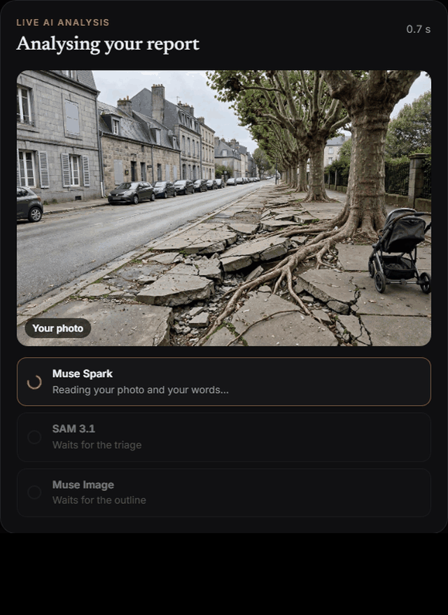
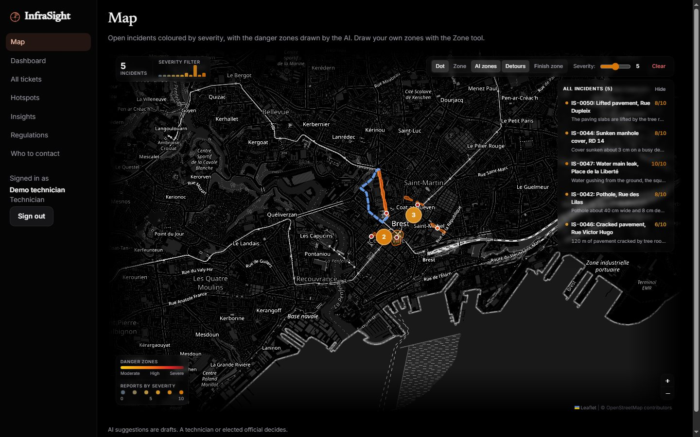
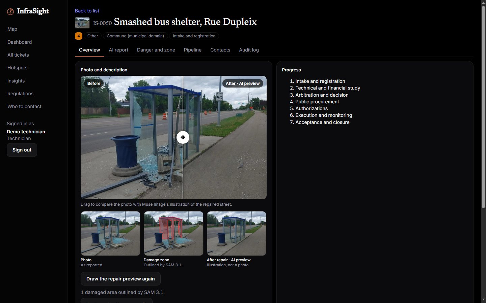
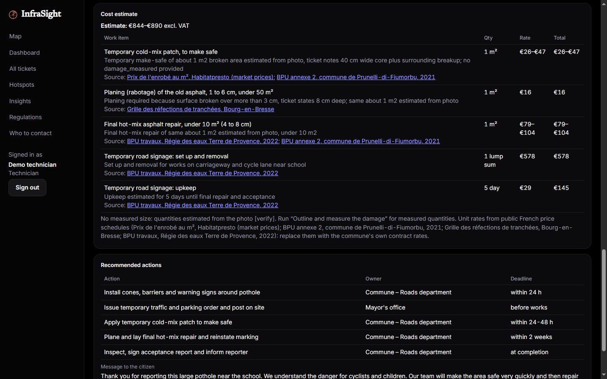
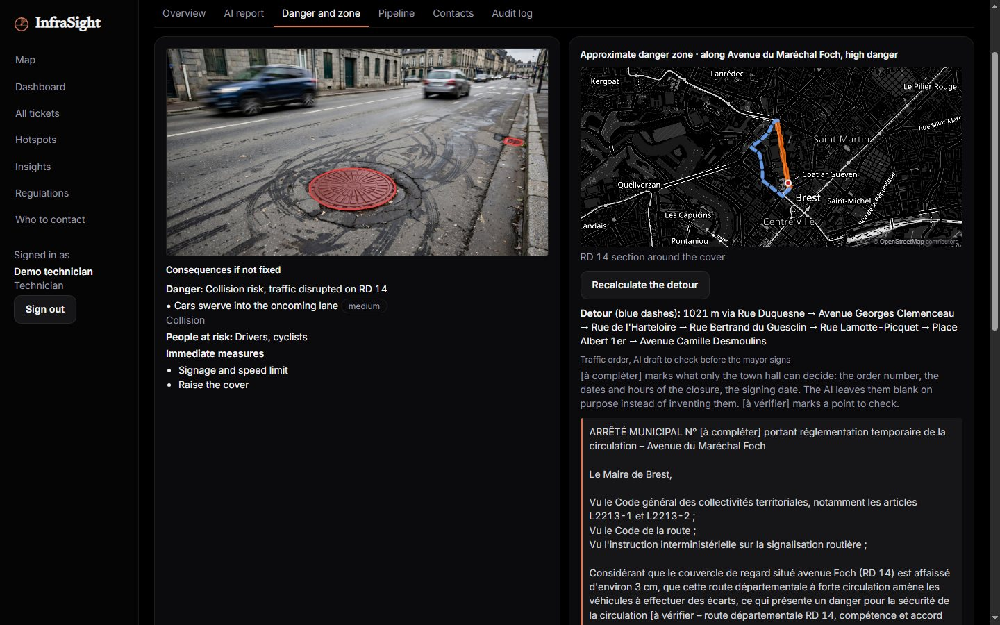
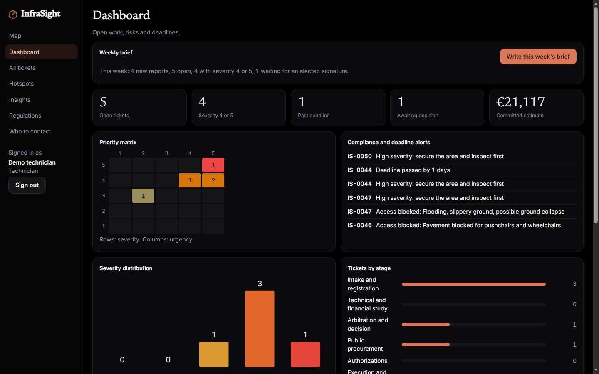
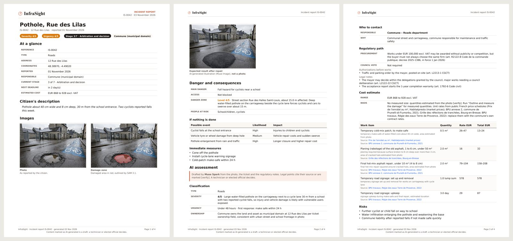
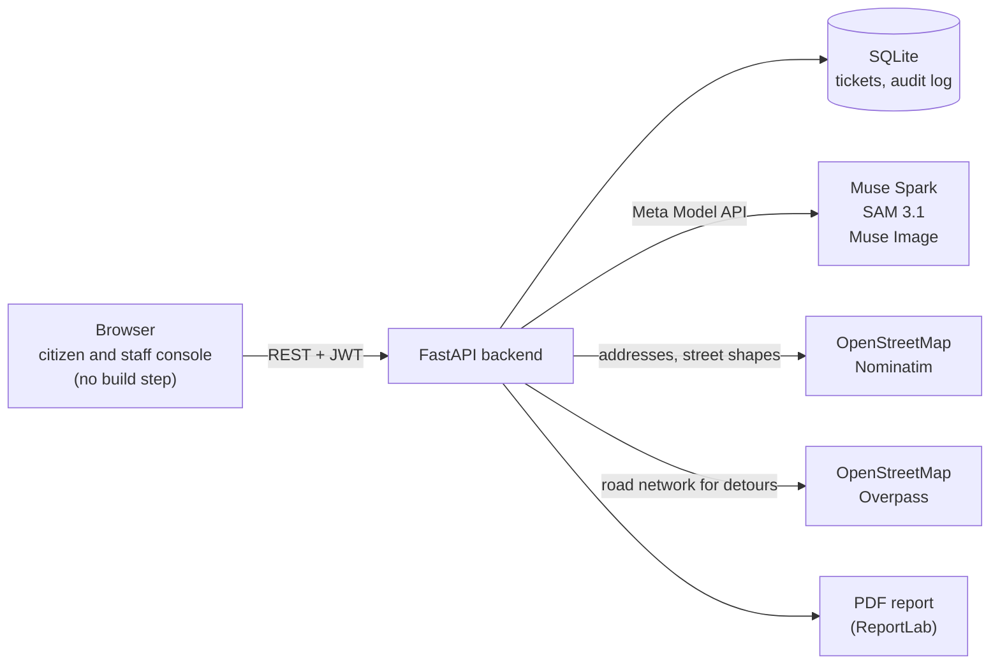

<p align="center">
  
</p>

<h1 align="center">InfraSight</h1>

<p align="center">
  <b>The AI co-pilot for city streets.</b><br>
  A citizen photographs a broken street. Three Meta models turn the photo into a case the town hall can act on:<br>
  classified, outlined pixel by pixel, priced from sourced rates, routed around, and drafted into legal documents.
</p>

<p align="center">
  <a href="https://github.com/abdo0620/InfraSight/actions/workflows/ci.yml"></a>
  
  
  
</p>

<p align="center">
  <b><a href="https://youtu.be/JLSLhUVK76s">Watch the demo video (3 min, YouTube)</a></b> ·
  <a href="#for-judges-run-it-in-5-minutes">Run it in 5 minutes</a> ·
  <a href="#what-to-try-in-3-minutes">What to try</a> ·
  <a href="AI-FUNCTIONS.md">Every AI call</a>
</p>

https://github.com/user-attachments/assets/d2dd6138-a23a-465a-a4e3-e84975360660

<p align="center"><sub>The trailer (1:35), with an original street beat composed in code for it.</sub></p>

---

<table>
<tr>
<td width="44%" valign="top">

<p align="center"><sub>A real citizen report of a smashed bus shelter: Muse Spark triages it, SAM 3.1 outlines the damage, Muse Image draws the shelter repaired. Sped up about 2.5×; the real run took 85 s.</sub></p>
</td>
<td valign="top">

### The problem
A pothole near a school is reported by text, email or phone. Someone at the town hall has to work out what it is,
how dangerous it is, who owns the road, what the repair will cost, which procurement rules apply, whether the street
needs closing and where traffic goes meanwhile. Each step takes days; the citizen hears nothing.

### What InfraSight does
The citizen sends **one photo and one sentence**, pinned on the map. Then:

- **Muse Spark** classifies it (type, severity, urgency, owner, danger zone), spots duplicates, and names the damage.
- **SAM 3.1** outlines the damage on the photo, pixel by pixel.
- **Muse Image** draws the same street once repaired, so everyone sees the goal.
- Staff get a **full report** with cited regulations, a **cost priced from public unit rates**, a **detour** computed
  on OpenStreetMap and a **draft traffic order** for the mayor, and AI drafts for each of the **7 legal stages**.
- The citizen gets **updates in their own language** at every step.

**AI drafts; people decide.** Every AI output is labelled, sourced or marked `[verify]`, and logged.

</td>
</tr>
</table>

## For judges: run it in 5 minutes

You need **Python 3.10+** (tested with 3.12 and 3.14) and an internet connection (maps come from OpenStreetMap).
A **Meta API key** (dev.meta.ai) is needed for the live AI; without one, everything else works and the 4 demo tickets
already show the SAM 3.1 outline and the Muse Image repair preview.

**Windows**: double-click `start.bat`. **macOS / Linux**: run `./start.sh`.

```bash
git clone https://github.com/abdo0620/InfraSight.git
cd InfraSight
./start.sh            # Windows: start.bat
```

The first run creates `backend/.venv`, installs the dependencies, and writes `backend/.env` with a random
`SECRET_KEY` and `DEMO_PASSWORD=demo1234`. Put your key in `backend/.env` (`META_API_KEY=...`), run the script again,
and open **http://localhost:8000**.

| Account | Password | Role |
|---|---|---|
| `citizen` | `demo1234` | reports problems, follows their own reports |
| `tech` | `demo1234` | municipal technician: the full pipeline |
| `elected` | `demo1234` | elected official: signs the decision stage |

<details>
<summary>Manual setup (without the scripts)</summary>

```bash
cd backend
python3 -m venv .venv && source .venv/bin/activate      # Windows: .venv\Scripts\activate
pip install -r requirements.txt
cp .env.example .env                                     # then set META_API_KEY and DEMO_PASSWORD=demo1234
uvicorn app.main:app --port 8000                         # site: http://localhost:8000, API docs: /docs
```
The backend serves the console too: opening `frontend/index.html` as a file does not work.
</details>

## What to try in 3 minutes

1. **Sign in as `citizen`**, click anywhere on the map, add a photo of a street problem and one sentence, then
   **Send report**. Watch the live AI analysis (about 1 to 2 minutes for the three models).
2. **Sign in as `tech`** and open **IS-0042** (Pothole, Rue des Lilas). Drag the **before / after** slider.
3. **AI report** tab, **Generate full report**: watch each step live, then read the cost estimate, with a source link
   on every priced line.
4. Open **IS-0044** (Sunken manhole cover), **Danger and zone** tab, **Plan a detour**: the route around the
   closed section and the mayor's draft traffic order.
5. **Download PDF report** on any ticket; then the **Dashboard**, and **Write this week's brief**.

## A tour

### The map
Open incidents coloured by severity, the danger zones the AI drew (a point, a whole street section, or an area),
detours in blue, streets with repeated problems in purple. **Clear** hides everything; **Show all** brings it back.



### The ticket: photo, damage, and the street repaired
The bus shelter from the report above: the citizen's photo, the damage outlined in red by **SAM 3.1**, and the
shelter repaired by **Muse Image**. The
preview keeps the real photo everywhere except the damaged area, so cars, signs and light never change. It is
labelled as an illustration everywhere.



### A cost estimate you can check
Muse Spark only chooses the work items and the quantities; **the server prices them** from a catalogue of unit
rates taken from public price schedules (for now French BPU), and every priced line links its source. Work the catalogue does not
cover is marked `[verify]` and a commune replaces the rates with those of its own contract
([backend/app/prices.py](backend/app/prices.py)).



### Detour and traffic order
For a danger zone that closes a street, InfraSight downloads the road network around it, computes the shortest
legal detour (one-way streets respected), and Muse Spark drafts the mayor's temporary traffic order. What only the
town hall can decide (order number, dates, signature) stays `[to fill]`: the AI does not invent it.



### Dashboard and weekly brief
Priority matrix, deadline and safety alerts, committed budget, and a weekly brief for elected officials written by
Muse Spark from the week's figures.



### The incident report, as a PDF
An A4 report with the four images, the danger, the AI assessment with its sources, the cost table, the 7 stages,
the detour, the history and the draft traffic order. Real selectable text, a title and a bookmark per section.



### Live progress for every AI action
Every AI button opens a panel showing the real steps the server is taking, with their results and timings (for
example SAM 3.1 → Muse Spark → red zone → Muse Image). If a step fails, that step says why and the next ones say
"Not started".

## How the Meta models are used

All three run on Meta's servers through the **Meta Model API** (`https://api.meta.ai/v1`), with one key. Nothing runs
on a local GPU.

| Model | What it does in InfraSight |
|---|---|
| **Muse Spark** (`muse-spark-1.3`) | Triage of each report, duplicate detection, full report with cited regulations, work items for the cost, real size of the damage from visible references, drafts for the 7 legal stages, traffic order, repair check (before / after photos), hotspot forecast, weekly brief, citizen updates in 9 languages |
| **SAM 3.1** (`sam-3.1`) | Outlines the damage on the photo. Triage names the object plainly ("bus shelter", "pothole"): SAM finds things by what they are, not their state. Outlines from several phrases are combined; if none lands where triage located the damage, SAM gets that box as a prompt |
| **Muse Image** (`muse-image-1.0`) | Draws the street repaired, from the photo and the red-marked copy; only the damaged area is kept from the drawing |

Costs and what the hackathon credit buys: [META-MODELS.md](META-MODELS.md). Every AI call, its inputs, outputs and
page: [AI-FUNCTIONS.md](AI-FUNCTIONS.md).

## Why the AI can be trusted with this

- **The browser never sends a prompt.** All prompts live in [backend/app/services/ai.py](backend/app/services/ai.py).
  Citizen text goes inside `<data>` tags declared untrusted, so a report cannot steer the model.
- **Structured output.** JSON answers are validated against schemas; an invalid answer is retried once with the
  error.
- **Sources or `[verify]`.** Every legal statement cites the regulatory notes it comes from, or is marked
  `[verify]`. Amounts come from sourced unit rates, never from the model.
- **Drafts, not decisions.** Severity, money, closures and signatures are decided by people with the right role.
  Only an elected official can sign the decision stage. Every action is in the audit log.
- **Honest images.** The repair preview is labelled as an illustration everywhere, including the PDF.
- **Every report is on the map.** A report needs a place pinned or picked from OpenStreetMap suggestions; the server
  refuses free-text locations.
- **Limits.** Each user gets 30 AI requests per hour. If the AI is down, a report is still saved for manual triage.

## Architecture



<details>
<summary>Project layout</summary>

```
start.bat / start.sh       one-command start (Windows / macOS, Linux)
frontend/                  static console, no build step, served by the backend
  index.html  css/styles.css
  js/app.js                views, live AI panels, charts, sign-in
  js/mapview.js            the Leaflet map: incidents, danger zones, detours, hotspots
  js/map.js                danger zone drawing (point / street / area), mini map in the ticket
  js/api.js                backend client: login token and one function per action (no prompts)
backend/                   FastAPI + SQLAlchemy + SQLite (infrasight.db, created on first start)
  app/routers/             auth, tickets (report, damage, preview, detour, stages, PDF), insights, stats
  app/services/ai.py       every prompt and Muse Spark / Muse Image call
  app/services/vision.py   SAM 3.1 outline
  app/services/visuals.py  red damage zone, repair preview, background pipeline after a report
  app/services/routing.py  detours on the OpenStreetMap road network
  app/services/geo.py      addresses, street shapes, address suggestions
  app/services/export.py   the PDF incident report
  app/services/progress.py live steps of an AI action
  app/prices.py            unit rates and their sources, used to price the cost estimate
  app/regulations.py       stages, checklists, directory, regulatory notes (single source)
  app/seed.py              4 demo tickets and the demo users
  app/cli.py               create staff accounts, change roles and passwords
```
</details>

<details>
<summary>Configuration (backend/.env)</summary>

| Variable | Default | Purpose |
|---|---|---|
| `META_API_KEY` | empty | key from dev.meta.ai; without it, reports are saved for manual triage |
| `MODEL_QUICK`, `MODEL_DEFAULT` | `muse-spark-1.1` | Muse Spark model for triage and updates / for everything else (`muse-spark-1.3` recommended) |
| `MODEL_IMAGE` | `muse-image-1.0` | repair preview |
| `COMMUNE_NAME` | empty | written in the drafted traffic orders, and used to find addresses nearby |
| `SECRET_KEY` | random per start | signs login tokens and photo links (the start scripts generate one) |
| `SEED_DEMO`, `DEMO_PASSWORD` | `true`, empty | demo tickets on an empty database, and the 3 demo accounts. Never in production |
| `DATABASE_URL` | `sqlite:///./infrasight.db` | any SQLAlchemy URL |
| `AI_CALLS_PER_HOUR` | 30 | per user |
| `DUPLICATE_RADIUS_M` | 80 | a new report this close to an open ticket may be merged into it |
| `OVERPASS_URLS` | 5 public servers | road data for detours, tried in order; a street's network is cached for a week |
</details>

<details>
<summary>Accounts and roles</summary>

- Citizens sign up on the sign-in screen. They see their own reports in full; other reports appear on the map and
  in the insights without photo, history or AI output.
- Staff accounts are created by an administrator: `python -m app.cli create-user jdupont tech "Jean Dupont"`
  (roles: citizen, tech, elected), also `set-role` and `set-password`.
- Technicians and elected officials run the pipeline; only an elected official signs the decision stage. The
  server writes every action to the audit log with the user's name.
</details>

<details>
<summary>All features</summary>

- **Duplicate merging.** A new report within 80 m of an open ticket that the AI judges to be the same problem is added
  to it: the citizen follows that ticket, the photo goes into its history, severity can rise. Staff can also merge by
  hand.
- **Live AI pipeline.** After "Send report", the citizen watches Muse Spark's triage, SAM 3.1's outline and Muse
  Image's repaired street appear, with timings. SAM and Muse Image run in the background on the server.
- **Damage zone.** First the box Muse Spark gives at triage, then the exact SAM 3.1 outline. "Outline and measure the
  damage" redoes it and has Muse Spark estimate the real size from visible references (kerb, road marking, manhole).
- **Repair preview and before / after slider.** Mouse, touch and keyboard. Once the work is done, the real
  after-repair photo replaces the illustration.
- **Danger zones.** `point`, `street` (the whole street section, shape from OpenStreetMap) or `area`; the colour
  follows the danger level, red when access is blocked.
- **Cost estimate** priced from sourced unit rates; the ticket's estimate follows the report.
- **Detour and traffic order**, with `COMMUNE_NAME`; staff can remove a detour from the ticket or from the map.
- **The 7 legal stages**, from intake to acceptance, with checklists and an AI draft for each stage.
- **Repair check.** At acceptance, the AI compares the after-repair photo with the citizen's.
- **Hotspots and forecast.** Streets with 2+ reports in 12 months; the AI proposes preventive work and a budget.
- **Updates** for citizens in their language (9 languages), and a weekly brief for elected officials.
- **PDF incident report** (not a fully tagged PDF/UA).
</details>

## Notes

- **Unit rates.** For now, the catalogue uses public French price schedules (BPU); a commune plugs in the rates of
  its own works contract. **Regulatory notes** follow French law and need a legal review before real use.
- **Public map services** (Nominatim, Overpass) are free and rate-limited; detours can take up to a minute on a busy
  day. A real deployment would run its own servers.
- **Hosting.** No hosted copy: the project runs from this repository. CI starts it on every push
  ([ci.yml](.github/workflows/ci.yml)): smoke tests on the API, `./start.sh` on a fresh checkout, JavaScript syntax.
- **Demo video.** Made with the code in [video/](video/): a short animated trailer ([Remotion](https://www.remotion.dev/)),
  then a live demo recorded in one take from the real app calling the real Meta Model API
  ([live/record_demo.py](video/live/record_demo.py), [live/assemble_demo.py](video/live/assemble_demo.py)). Live AI
  calls and typing are sped up, and the video says so on screen with the real duration. The take is recorded in slow
  motion and played back at real speed, for smooth motion from a headless browser.
- **Music and sound effects.** All original, synthesized from code for this video and for the
  [trailer](docs/video/infrasight-trailer.mp4) (a laid-back street beat: 808 bass, swung hats, electric piano)
  ([audio/make_music.py](video/audio/make_music.py), [audio/make_sfx.py](video/audio/make_sfx.py),
  [audio/synth.py](video/audio/synth.py)). No samples, loops or third-party recordings are used.

## Built during the Meta Global AI Developer Hackathon

Everything in this repository was written during the hackathon (first commit 29 Oct 2026, building period
27 Oct - 4 Nov 2026).

**Next steps:** PostgreSQL + PostGIS with migrations; own Nominatim and Overpass servers; a legal review of
`regulations.py`; password reset by email and login attempt limiting; real deadline dates instead of day counts.
